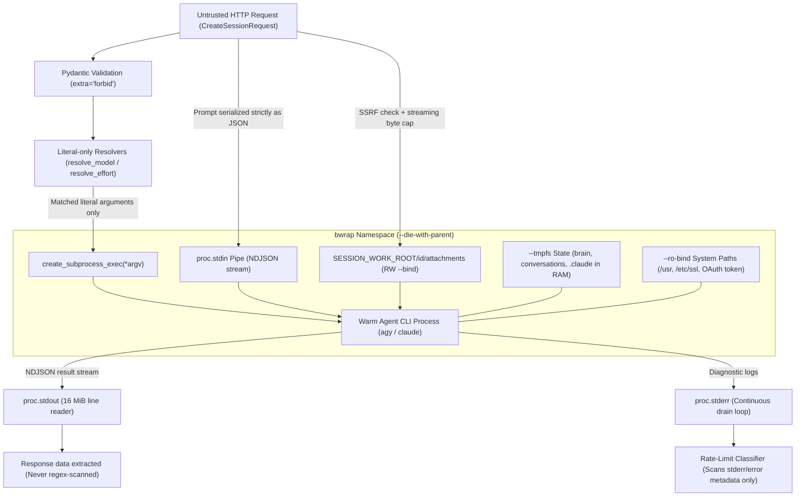

# Security Architecture & Posture

## Overview
`agent-api` provides isolated execution for agentic AI tasks (`agy`, `claude`, `codex`). Because the service accepts prompts and attachments over local and remote networks, security controls are layered across confinement, network isolation, authentication, and rate limiting.

## Security Controls

### 1. Fail-Closed Sandbox Confinement
- Jobs run confined inside Linux namespaces via `bubblewrap` (`bwrap`).
- Mount points are restricted to essential read-only system paths (`/usr`, `/bin`, `/lib`, `/etc/resolv.conf`, `/etc/ssl`).
- The user home directory and API keys are isolated via clean `--tmpfs` mounts.
- **Fail-Closed Policy**: If `bwrap` is missing or unexecutable, `agent-api` **refuses to run unconfined** by default (`ALLOW_UNCONFINED=0`), failing the job with an error log.
- **Escape Hatch**: Setting `ALLOW_UNCONFINED=1` permits unconfined execution but logs a loud `WARNING` on every job.
- **Preflight Check**: `/healthz` reports `"confinement": {"enabled": true, "available": true, "mode": "enforced"}`.

### 2. SSRF Protection & Per-Hop Redirect Validation
- Attachment URLs (`http://`, `https://`) are strictly validated against restricted IP ranges (loopback `127.0.0.0/8`, private `10.0.0.0/8`, `172.16.0.0/12`, `192.168.0.0/16`, link-local `169.254.0.0/16`).
- **Per-Hop Validation**: `httpx` automatic redirect following is disabled. Every redirect hop (`301`, `302`, `303`, `307`, `308`) is manually validated against SSRF rules before fetching the new URL, capping total redirects at 5.
- Prevents public URLs from redirecting callers to internal localhost services (`jellyfin`, `filebrowser`, `prod-surf`, `chords`, `csr`).

### 3. Named API Keys & Constant-Time Comparison
- Authentication supports multiple named keys (`API_KEYS=name1:key1,name2:key2`) alongside legacy single `API_KEY` (name `"default"`).
- Key verification uses `secrets.compare_digest` to prevent timing attacks.
- Only the **key name** (e.g. `"laptop"`, `"rondeau"`, `"default"`, or `"bypass"`) is recorded on job rows and logs — raw secret keys are NEVER logged.

### 4. Sliding-Window Rate Limiting & Queue Depth Cap
- Per-caller sliding window rate limiting (`RATE_LIMIT_PER_MIN=60`). Exceeding quota returns `HTTP 429 Too Many Requests` with a `Retry-After` header.
- Pending queue depth is capped (`MAX_PENDING_JOBS=100`). Submissions beyond capacity return `HTTP 429`.
- `/healthz` and `/dashboard` endpoints bypass rate limiting.

### 5. One-Way Authentication Alerting
- Auth failure metrics are exposed via `GET /v1/stats/security?since=`.
- A separate watchdog script in `/home/ubuntu/agent/check_agent_api_auth.py` monitors this endpoint over loopback (`http://127.0.0.1:8090`) via a dedicated systemd user timer (`agent-api-auth-check.timer`).
- Threshold-exceeding failures trigger programmatic Telegram alerts with 30-minute deduplication. `agent-api` retains zero Telegram code or credentials.

### 6. Warm Session Confinement & Stdio Trust Boundary
For multi-turn conversational sessions (`/v1/sessions`), the execution boundary strictly separates control arguments from untrusted data:

Key security properties:
- **Zero Caller Strings in Subprocess Argv**: `model` and `effort` are resolved against static literal sets; untrusted user inputs never reach `argv` or shell execution (Security Invariant #1).
- **Prompt Data Isolation**: User prompts are serialized strictly as NDJSON over `proc.stdin`.
- **Pure In-Memory Session State**: Agent working directories (`brain`, `conversations`, `.claude`) reside on `--tmpfs` mounts in RAM, completely isolated between sessions and vanished immediately upon process group termination.
- **Attachment Quotas & Cumulative Caps**: Attachments uploaded across multiple turns are saved under `<session_ws>/attachments/` enforcing streaming `MAX_TOTAL_BYTES` checks and SSRF redirect validation.
- **Agent Output is Data, Never Control**: Agent responses are treated strictly as output data. The rate-limit classifier never scans response text, preventing OCR strings (such as prices like `$ 429,00` or addresses like `AV ITALIA 4429`) from triggering accidental AIMD rate-limit backoffs (Security Invariant #8).

## Residual Risks & Accepted Decisions

1. **Prompt-Injection Egress Exfiltration (Accepted / Research-Gated)**:
   - CLI agents require outbound network access to reach Anthropic, Google, and OpenAI API endpoints, as well as package managers and documentation endpoints.
   - Neither provider publishes fixed static IP allowlists. Outbound egress filtering is configurable via `EGRESS_RESTRICT` (default `0`).

2. **Sensitive Data at Rest (Accepted)**:
   - Job prompts and outputs are stored unencrypted in `data/jobs.db` with a 30-day automatic retention sweeper (`JOB_RETENTION=30d`).
