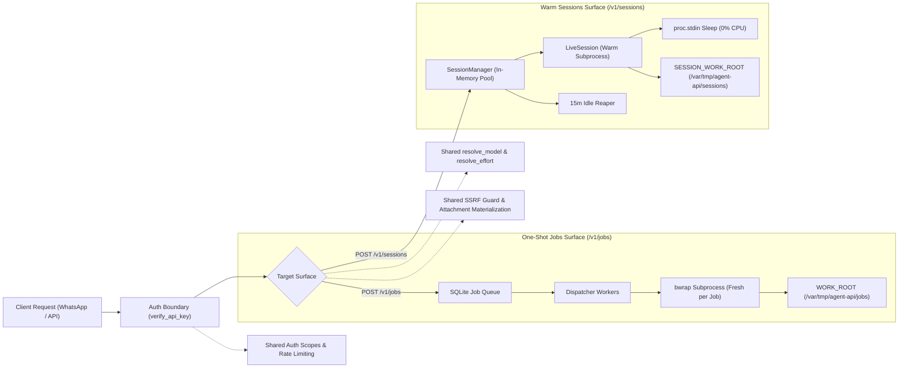
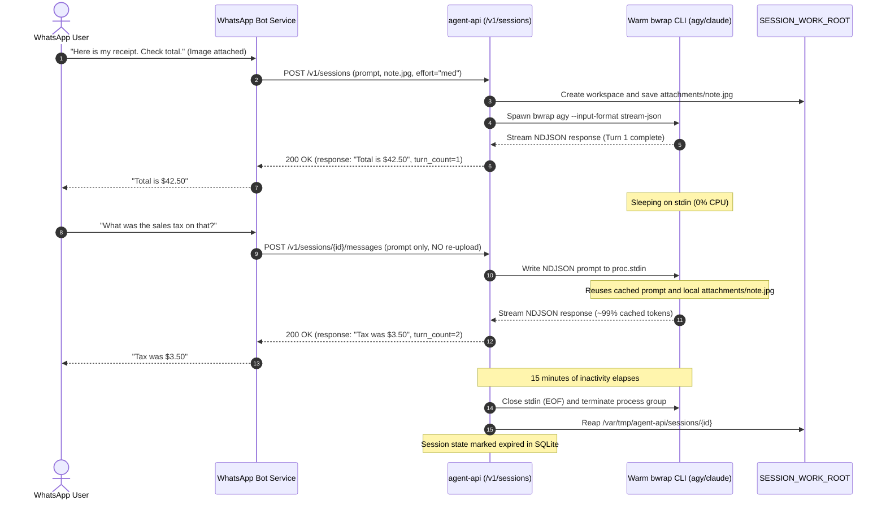
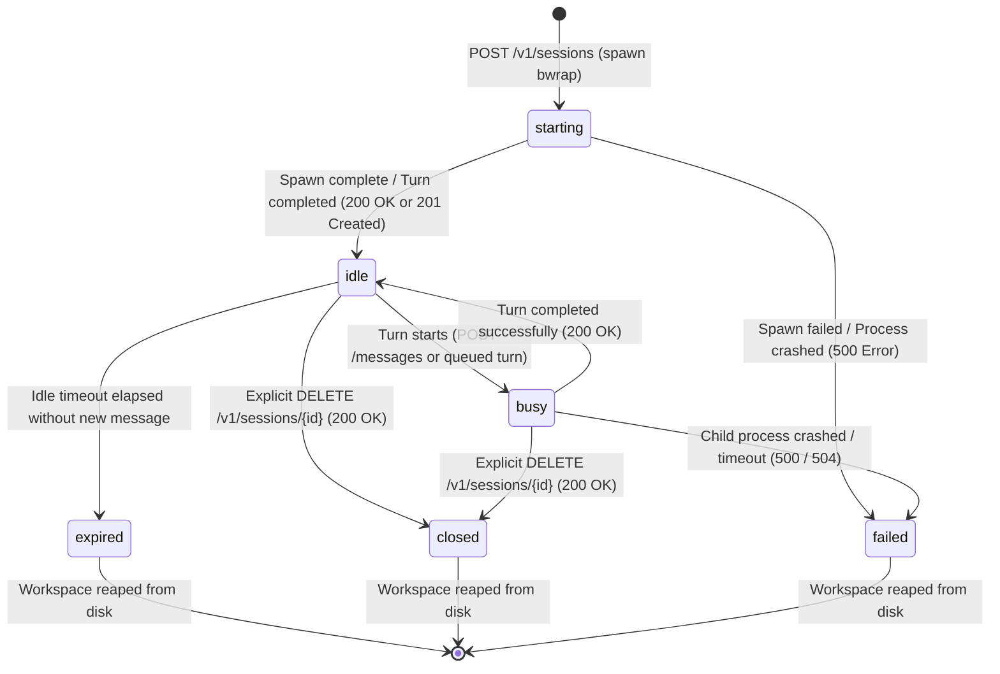
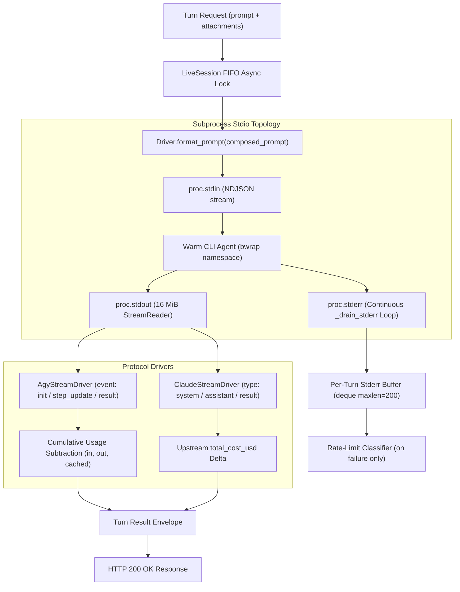
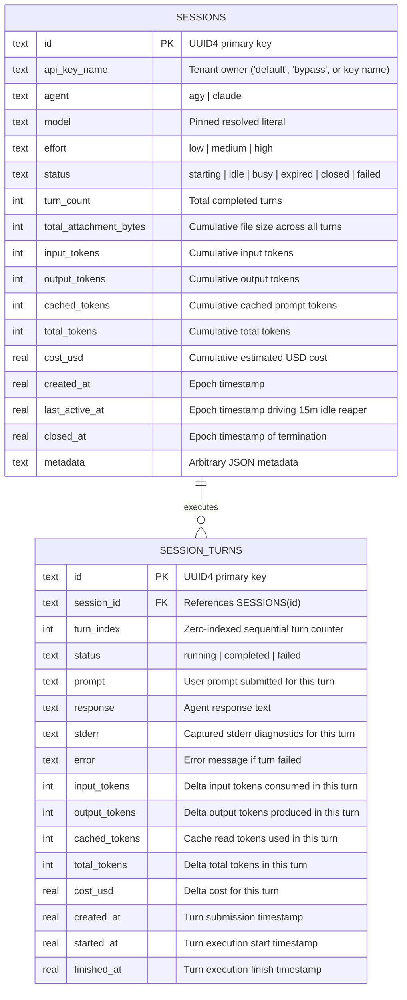

# Multi-Turn Warm Sessions (`/v1/sessions`)

## Overview & Architecture

`agent-api` provides two parallel execution surfaces:
1. **One-Shot Jobs (`/v1/jobs`)**: An asynchronous background job queue designed for non-interactive batch document processing and OCR. Each job spawns a fresh `bwrap` subprocess, executes a single prompt, persists the output in SQLite, and cleans up the workspace.
2. **Warm Conversational Sessions (`/v1/sessions`)**: An interactive, multi-turn execution surface designed for conversational frontends (e.g. WhatsApp, Slack, web chat). A single `bwrap` subprocess remains running in the background while sleeping at 0% CPU on `stdin`. Successive turns reuse the warm subprocess and in-memory LLM state, achieving ~99% prompt cache hits without re-uploading attachments or re-transmitting conversation history.



---

## Multi-Turn Conversation & Prompt Cache Flow

In chat applications such as WhatsApp bots, users submit sequential messages and attachments over an extended dialogue. With warm sessions:
- **Turn 1**: The client creates a session with `POST /v1/sessions`, optionally supplying an initial prompt, model (`"flash"`), effort (`"low"` or `"med"`), and attachments (e.g. an invoice image or receipt). The session is allocated an isolated directory in `SESSION_WORK_ROOT/<session_id>/`, starts `bwrap`, materializes files into `attachments/`, and runs Turn 1.
- **Turn 2+**: When the user follows up via `POST /v1/sessions/<session_id>/messages`, the prompt is written directly to the warm process's `stdin`. The LLM agent reads the existing attachments on disk and leverages server-side prompt cache tokens, reducing turn latency and token consumption by up to 90–99%.
- **Double-Text Handling**: A per-session FIFO lock serializes overlapping incoming messages. If a user double-texts before Turn 1 finishes, Turn 2 queues behind it safely up to `MAX_QUEUED_TURNS_PER_SESSION`.
- **Idle Auto-Close**: An automated idle reaper checks `last_active_at`. If no message arrives within `SESSION_IDLE_TIMEOUT` (default 15 minutes), the process is signaled with `EOF`, terminated, and its workspace reaped.



---

## Session State Machine

The session lifecycle transitions through the following formal states:



### HTTP Status Code Semantics
- **`200 OK`**: Synchronous turn execution completed; returns session summary and `latest_turn`.
- **`201 Created`**: Spawn-only creation (`POST /v1/sessions` without prompt or with whitespace prompt). Session spawned in `"idle"` state.
- **`202 Accepted`**: Background turn execution (`wait=0` or `wait` seconds elapsed while turn continues in background).
- **`400 Bad Request`**: Invalid JSON body, empty message prompt, unknown/unavailable agent, or attachment validation failure.
- **`404 Not Found`**: Session does not exist or belongs to another API key tenant (Security Invariant #2).
- **`409 Conflict`**: Message posted to an inactive session (`expired`, `closed`, or `failed`). Signals the WhatsApp bot to spawn a fresh session.
- **`422 Unprocessable Content`**: Request payload contains unknown fields (`extra="forbid"`).
- **`429 Too Many Requests`**: `MAX_ACTIVE_SESSIONS` reached (system-wide) or `MAX_QUEUED_TURNS_PER_SESSION` reached (per-session).
- **`504 Gateway Timeout`**: Turn execution exceeded `turn_timeout` (process killed, session marked `"failed"`).

---

## Stream Driver & Pipe Topology

CLI agents run inside `bwrap` with bidirectional stdio pipes. The driver normalizes JSON differences between `agy` and `claude`.



### Stdio Safety Guarantees
1. **16 MiB Line Reader**: `proc.stdout` uses an explicit 16 MiB limit (`asyncio.StreamReader(limit=16 * 1024 * 1024)`) so large multi-turn JSON payloads never trigger `LimitOverrunError`.
2. **Continuous Stderr Draining**: Background task `_drain_stderr` consumes stderr continuously in 4 KiB chunks into a rolling deque (`maxlen=200`). This prevents pipe buffer exhaustion and deadlock if an agent emits verbose diagnostic logs.
3. **Per-Turn Stderr Isolation**: The buffer is cleared at the start of each turn (`live.stderr_buffer.clear()`) so previous turn warnings never pollute subsequent turn rate-limit checks.
4. **Data vs. Control Flow**: Response payloads are data, never control signals. Rate-limit checks scan stderr and error metadata only, never agent responses (Security Invariant #8).

---

## SQLite Database Schema

Sessions and turns are persisted in SQLite, providing full auditability and multi-tenant isolation.



---

## HTTP Endpoint Reference

All routes require authentication via `X-API-Key` or trusted loopback bypass with the `jobs` scope.

### 1. Create Warm Session (`POST /v1/sessions`)
Spawns a new warm agent process. Accepts JSON or `multipart/form-data`.

**Request Body (JSON)**:
```json
{
  "agent": "agy",
  "model": "flash",
  "effort": "low",
  "prompt": "Remember secret code DELTA-7 and analyze invoice.pdf",
  "attachments": [
    {
      "filename": "invoice.pdf",
      "content_b64": "JVBERi0xLjQK..."
    }
  ],
  "idle_timeout": 900,
  "turn_timeout": 120,
  "wait": 60,
  "metadata": {"user_id": "whatsapp:+1234567890"}
}
```

**Response (`200 OK` when `prompt` provided and executed)**:
```json
{
  "id": "e3b0c442-98fc-1c14-9afb-4c8996fb9242",
  "agent": "agy",
  "model": "gemini-3.8-flash-low",
  "effort": "low",
  "status": "idle",
  "turn_count": 1,
  "total_attachment_bytes": 102400,
  "input_tokens": 450,
  "output_tokens": 85,
  "cached_tokens": 0,
  "total_tokens": 535,
  "cost_usd": 0.000395,
  "created_at": 1700000000.0,
  "last_active_at": 1700000005.0,
  "expires_at": 1700000905.0,
  "latest_turn": {
    "id": " turn-uuid-1",
    "turn_index": 0,
    "status": "completed",
    "response": "I have reviewed invoice.pdf and remembered code DELTA-7.",
    "input_tokens": 450,
    "output_tokens": 85,
    "cached_tokens": 0,
    "cost_usd": 0.000395
  }
}
```

If `prompt` is omitted or whitespace, returns `201 Created` with `status: "idle"`, `turn_count: 0`, and `latest_turn: null`.

### 2. Send Follow-Up Message (`POST /v1/sessions/{id}/messages`)
Sends a follow-up turn to an active session. Reuses existing context and attachments.

**Request Body (JSON)**:
```json
{
  "prompt": "What was the total amount on the invoice?",
  "wait": 60
}
```

**Response (`200 OK`)**:
```json
{
  "id": "e3b0c442-98fc-1c14-9afb-4c8996fb9242",
  "status": "idle",
  "turn_count": 2,
  "cached_tokens": 450,
  "latest_turn": {
    "turn_index": 1,
    "status": "completed",
    "response": "The total amount on invoice.pdf is $1,250.00.",
    "input_tokens": 45,
    "output_tokens": 20,
    "cached_tokens": 450,
    "cost_usd": 0.0000625
  }
}
```

### 3. Inspect Session (`GET /v1/sessions/{id}`)
Retrieves session details and optionally full turn history.

**Parameters**:
- `include_turns` (query boolean, default `false`): Include all historical turns.

### 4. List Active Sessions (`GET /v1/sessions`)
Lists sessions belonging to the caller's tenant.

**Parameters**:
- `status` (query string, optional): Filter by `idle`, `busy`, `expired`, etc.
- `limit` (query int, default `50`).

### 5. Close Session (`DELETE /v1/sessions/{id}`)
Terminates the warm `bwrap` process group immediately and reaps its workspace. Idempotent.

---

## Interactive Local Testing (`scripts/dev-server.sh` & `scripts/session-cli`)

Two zero-dependency helper scripts live in `scripts/` for interactive testing without disturbing the deployed `:8090` service:

- **`scripts/dev-server.sh`**: Starts/stops an isolated loopback `uvicorn` instance (default `127.0.0.1:8091`, refusing `8090`) backed by `/tmp/agent-api-dev-8091/` (`SSH_CONNECTION=1`, `BWRAP_ENABLED=1`) and automatically seeds `~/.cache/agent-api/session-cli.json` (`0600`).
- **`scripts/session-cli`**: Stateful Python 3 client & interactive REPL that caches `url`, `api_key`, and the active `session_id` in `~/.cache/agent-api/session-cli.json` (defaulting to `http://127.0.0.1:8090` when no dev server is active).

### 0. Spin Up (and Tear Down) a Side-by-Side Test Server
```bash
./scripts/dev-server.sh start          # starts 127.0.0.1:8091 & configures session-cli
./scripts/dev-server.sh status         # check PID & /healthz
./scripts/dev-server.sh logs           # view recent server logs
./scripts/dev-server.sh stop           # closes sessions, stops :8091, wipes /tmp dir, resets URL to :8090
```

### 1. Interactive REPL Mode (`telnet`-style live chat)
Run with no arguments to attach to the cached warm session (or spawn a fresh one):
```bash
./scripts/session-cli
# Commands inside REPL:
#   /status                        Show live server health & idle countdown
#   /history                       Show all turns in the session
#   /attach ./receipt.jpg <prompt> Upload a local file with your turn
#   /new agy flash med             Start a fresh session with new model/effort
#   /close                         Kill remote session & reap workspace
#   /quit (or Ctrl+D)              Exit REPL while keeping session warm
```

### 2. Repeated One-Shot CLI Mode
Each invocation automatically reuses the cached `session_id` (and transparently opens a fresh session if the previous one expired after 15m idle):
```bash
# Save target server & key once (if not already pre-configured):
./scripts/session-cli --url http://127.0.0.1:8091 --key "$AGENT_API_KEY" --save-config

# Turn 1 (spawns warm session & caches session_id):
./scripts/session-cli "Remember codeword MANGO-42"

# Turn 2 (reuses cached session_id):
./scripts/session-cli "What codeword did I tell you?"

# Attach a local file on any turn:
./scripts/session-cli -f ./invoice.pdf "What is the total?"

# Inspect or close:
./scripts/session-cli --status
./scripts/session-cli --close
```

---

## WhatsApp Bot Integration Guide

A conversational bot (e.g. Baileys, WhatsApp Business API, Twilio) should implement the following state caching pattern:

```javascript
// Example Node.js WhatsApp session handler
async function handleUserMessage(chatId, text, mediaAttachment) {
  let sessionId = await cache.get(`session:${chatId}`);

  if (!sessionId) {
    // 1. First turn: create new session
    const res = await api.post("/v1/sessions", {
      agent: "agy",
      model: "flash",
      effort: "low",
      prompt: text,
      attachments: mediaAttachment ? [mediaAttachment] : []
    });
    sessionId = res.data.id;
    await cache.set(`session:${chatId}`, sessionId, 15 * 60); // 15m TTL
    return res.data.latest_turn.response;
  }

  // 2. Subsequent turn: send message to existing session
  try {
    const res = await api.post(`/v1/sessions/${sessionId}/messages`, {
      prompt: text,
      attachments: mediaAttachment ? [mediaAttachment] : []
    });
    await cache.expire(`session:${chatId}`, 15 * 60); // refresh TTL
    return res.data.latest_turn.response;
  } catch (err) {
    if (err.response && err.response.status === 409) {
      // 3. Session expired or closed: seamlessly start a fresh session
      const freshRes = await api.post("/v1/sessions", {
        agent: "agy",
        model: "flash",
        effort: "low",
        prompt: text,
        attachments: mediaAttachment ? [mediaAttachment] : []
      });
      await cache.set(`session:${chatId}`, freshRes.data.id, 15 * 60);
      return freshRes.data.latest_turn.response;
    }
    throw err;
  }
}
```

---

## Operational Tuning & Capacity Planning

Configure the following environment variables in `~/.config/agent-api/env`:

| Setting | Default | Description | Recommended Production Setting |
| :--- | :--- | :--- | :--- |
| `SESSION_WORK_ROOT` | `/var/tmp/agent-api/sessions` | Isolated directory tree for warm session workspaces. Must NOT overlap `WORK_ROOT`. | Dedicated tmpfs or fast NVMe partition. |
| `SESSION_IDLE_TIMEOUT` | `900` (15 min) | Inactivity threshold before warm process termination and workspace reaping. | `600` to `1200` seconds based on user interaction patterns. |
| `SESSION_IDLE_MAX` | `3600` (60 min) | Maximum allowed `idle_timeout` configurable by client requests. | `1800` to `3600` seconds. |
| `SESSION_TURN_TIMEOUT` | `120` (2 min) | Maximum execution time per individual turn before process group SIGKILL. | `120` to `180` seconds. |
| `MAX_ACTIVE_SESSIONS` | `10` | Hard cap on total concurrently warm subprocesses across all tenants. | Set based on host RAM (~150 MB per warm `bwrap` process). |
| `MAX_QUEUED_TURNS_PER_SESSION` | `3` | Maximum pending messages queued on a single session's FIFO lock. | `3` to `5` to prevent WhatsApp double-text buildup. |
| `ATTACHMENT_HOST_ALLOWLIST` | `""` | Comma-separated list of allowed domains for URL attachment fetching. | Set to trusted S3 / WhatsApp CDN hostnames. |
